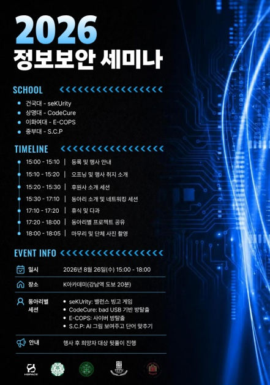
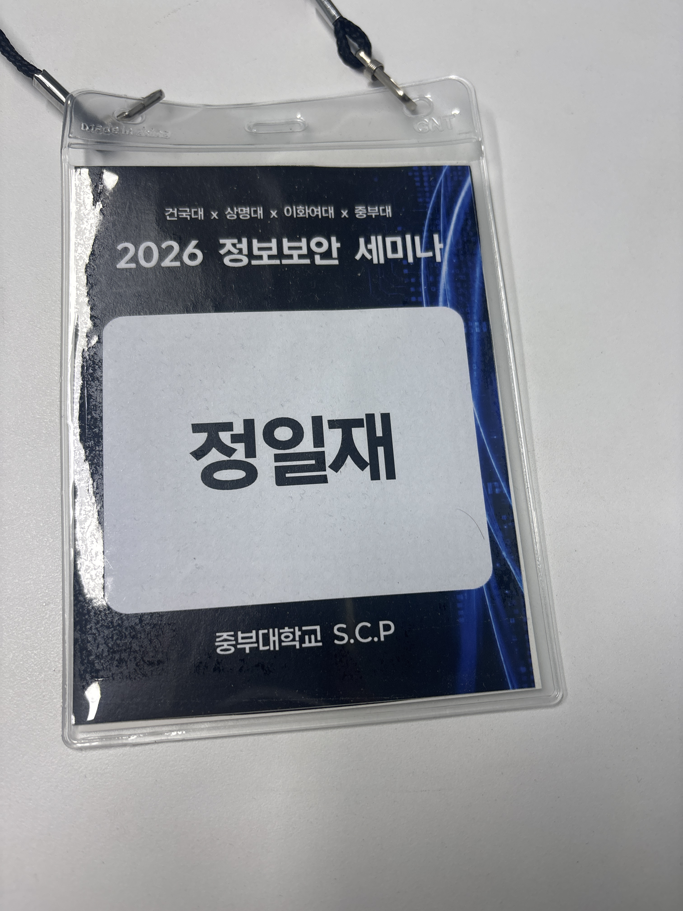

2026년 8월 26일 , **중부대학교 S.C.P**와 **건국대학교(글로컬캠퍼스) seKUrity**, **상명대학교 CodeCure**, **이화여자대학교 E-COPS** 4개 대학의 정보보안 동아리가 강남 K아카데미에 모여 **2026 연합 정보보안 세미나**를 진행했습니다.

서로 다른 학교에서 보안을 공부하는 부원들과 직접 만나 프로젝트를 공유하고 네트워킹을 즐길 수 있어 뜻깊은 시간이었다.

---

## 📌 행사 개요

- **일시**: 2026년 8월 26일 (수) 15:00 ~ 18:00
- **장소**: K아카데미
- **참여 동아리**:
  - **중부대학교**: S.C.P
  - **건국대학교 (글로컬캠퍼스)**: seKUrity
  - **상명대학교**: CodeCure
  - **이화여자대학교**: E-COPS

---

## ⏱️ 주요 타임라인 & 참가 일지

| 시간 | 프로그램 | 비고 |
| :--- | :--- | :--- |
| **15:00 - 15:10** | 등록 및 행사 안내 | 현장 도착 및 출석 체크 |
| **15:10 - 15:30** | 오프닝 & 후원사 소개 | 세미나 취지 안내 및 세션 준비 |
| **15:30 - 17:10** | 동아리 소개 & 네트워킹 세션 | 각 동아리별 준비 게임 참여 |
| **17:10 - 17:20** | 휴식 및 다과 | 자유로운 담소 시간 |
| **17:20 - 18:00** | 동아리별 프로젝트 공유 | 주요 연구/프로젝트 발표 세션 |
| **18:00 - 18:05** | 단체 사진 촬영 및 마무리 | 행사장 정리 및 뒷풀이 이동 준비 |

---

## 🎮 동아리별 세션 참여 & S.C.P 활동

이번 세미나에서는 각 동아리가 아이스브레이킹과 방탈출/퀴즈 프로그램들을 준비했습니다.

* **S.C.P (중부대)**: S.C.P에서는 **'AI 그림 보고 단어 맞추기'** 세션을 준비했습니다. AI가 생성한 이미지 속 보안 키워드나 힌트를 맞히는 형식이었는데, 예상보다 더 재밌었습니다.
* **seKUrity (건국대)**: 밸런스 빙고 게임을 진행하며 자연스럽게 이야기를 나눴습니다.
* **CodeCure (상명대)**: Bad USB 기반 방탈출 문제에 직접 참여해보며 흥미로운 보안 기믹을 체감할 수 있었습니다.
* **E-COPS (이화여대)**: 사이버 방탈출 세션을 풀어보며 웹 및 시스템 관점의 문제들을 함께 논의했습니다.

이어진 **동아리별 프로젝트 공유 세션**에서는 각 학교에서 준비해 온 프로젝트와 보안 연구 내용들을 들으며 시야를 더욱 넓힐 수 있었습니다.
