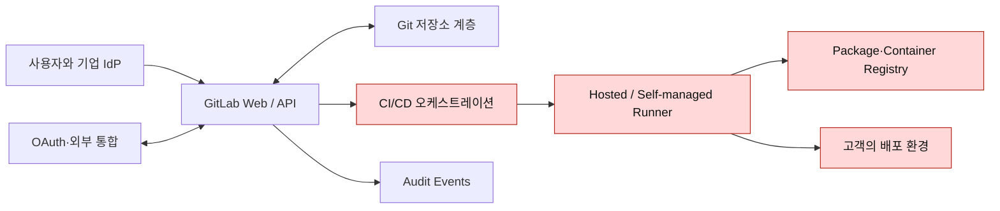
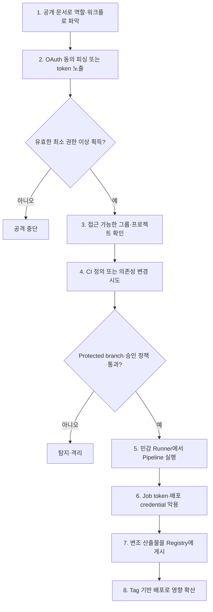

## 1. 대상 회사 선정 및 기본 정보 조사

### 1.1 들어가며

이번 미션은 실제로 존재하는 회사를 대상으로 공개 정보만 조사해 모의침투 시나리오를 설계하는 것이다. 대상은 **GitLab Inc.**로 정했다. GitLab은 소스 코드 저장소, 이슈, CI/CD, 패키지·컨테이너 레지스트리와 배포 기능을 한 플랫폼에서 제공한다. 공격자가 한 계정이나 토큰을 탈취했을 때 코드에서 빌드와 배포까지 영향이 이어질 수 있어, 현대적인 소프트웨어 공급망의 신뢰 경계를 분석하기 적합하다.

이 글은 2026년 10월 14일에 확인한 GitLab의 공식 웹사이트·문서·Handbook·상태 페이지만을 근거로 작성했다. **GitLab.com에 스캔, 계정 생성, 로그인 시도, 취약점 검증, 요청 자동화 또는 공격 페이로드 전송을 하지 않았다.** 따라서 아래의 취약점은 발견 사실이 아니라 공개된 기능과 보안 문서로부터 도출한 가설이다.

> GitLab은 GitLab.com 침투 테스트에 사전 서면 승인이 필요하다고 명시한다. 실제 연구는 현재 Bug Bounty 정책을 먼저 확인하고, 가능한 경우 GitLab Development Kit(GDK)나 연구자가 소유한 로컬 인스턴스에서 수행해야 한다.  
> 출처: [GitLab Coordinated Disclosure Process](https://about.gitlab.com/security/disclosure/), [2026 Bug Bounty 정책 안내](https://about.gitlab.com/blog/gitlab-bug-bounty-program-policy-updates/)

### 1.2 조사 범위와 방법

#### 조사 원칙

| 구분 | 이번 글에서 수행 | 수행하지 않음 |
|---|---|---|
| 회사 조사 | 공식 회사 소개와 보안 페이지 열람 | 임직원 개인 정보 수집 |
| 자산 조사 | 공식 상태 페이지에 공개된 서비스 분류 | 서브도메인 브루트포스, 포트 스캔 |
| 구조 조사 | 공식 제품 문서와 Production Architecture 열람 | 원격 시스템 지문 수집, 버전 추정 |
| 시나리오 | 기능과 신뢰 경계에 기반한 가설 수립 | 공격 재현, 인증 우회, 데이터 접근 |
| 검증 환경 | 문서 수준 검토 | GitLab.com 대상 능동 테스트 |

조사 결과에는 세 가지 표기를 사용한다.

- **확인**: GitLab 공식 문서에서 직접 확인한 사실
- **가설**: 확인된 기능을 조합해 만든 예상 공격 경로
- **미확인**: 실제 설정·취약 여부를 알 수 없어 검증이 필요한 부분

### 1.3 대상 회사: GitLab Inc.

GitLab Inc.는 GitLab 플랫폼을 개발·운영하는 상장 회사다. 회사 소개에 따르면 2011년 오픈 소스 프로젝트로 시작했고, 현재는 코드 작성부터 배포까지 연결하는 소프트웨어 개발 플랫폼을 제공한다. GitLab.com은 SaaS 서비스이며 동일 제품은 Self-Managed와 Dedicated 형태로도 제공된다.

- 회사: GitLab Inc.
- 대표 서비스: GitLab.com
- 핵심 가치 자산: 사용자 계정, 비공개 저장소, 소스 코드, CI/CD 변수, 액세스 토큰, 빌드 산출물, 패키지·컨테이너 이미지, 배포 권한, 감사 로그
- 주요 이해관계자: 개인 개발자, 기업 그룹 관리자, 프로젝트 Maintainer, Runner 운영자, 외부 OAuth 애플리케이션, 패키지 소비자

출처: [About GitLab](https://about.gitlab.com/company/), [GitLab Trust Center](https://about.gitlab.com/security/)

_GitLab 공식 회사 소개에서 플랫폼의 성격과 회사 기본 정보를 확인_

## 2. 홈페이지 및 공개 자산 조사

### 2.1 공개 서비스 자산

GitLab 상태 페이지는 GitLab.com의 운영 구성요소를 공개한다. 여기에는 Website, API, Git Operations, Package Registry, Container Registry, GitLab Pages, CI/CD, Hosted Runner, SAML SSO, Background Processing, Customers Portal, Support, 문서와 포럼 등이 포함된다. 이는 취약한 호스트 목록이 아니라 **방어 관점의 자산 분류표**로 사용했다.

| 자산군 | 공개적으로 확인된 기능 | 보호해야 할 정보·권한 |
|---|---|---|
| Web / API | 프로젝트·그룹·사용자 작업, REST API | 세션, 계정 권한, 프로젝트 데이터 |
| Git Operations | clone, fetch, push | 소스 코드의 기밀성·무결성 |
| CI/CD / Runner | 파이프라인 실행, Job token 발급 | 변수, Runner, 빌드·배포 권한 |
| Package / Container Registry | 패키지와 이미지 저장·배포 | 산출물 무결성, 소비자 신뢰 |
| Pages | 저장소 기반 정적 사이트 게시 | 도메인 신뢰, 게시 콘텐츠 |
| SAML SSO / OAuth | 기업 인증과 위임 접근 | 사용자·그룹 식별자, 토큰 scope |
| Support / Customers Portal | 고객 지원과 구독 관리 | 고객 정보, 지원 요청, 계약 정보 |
| Docs / Forum | 문서와 커뮤니티 | 브랜드 신뢰, 사회공학 단서 |

출처: [GitLab System Status](https://status.gitlab.com/)

_상태 페이지에 공개된 Website, API, Git Operations, Registry, Pages, CI/CD 등의 서비스 구성요소_

### 2.2 공개된 Production Architecture

공식 Production Architecture에 따르면 GitLab.com의 핵심 인프라는 주로 GCP `us-east1`에 있고, 대부분은 Kubernetes에 배포된다. PostgreSQL, Gitaly, Redis, Elasticsearch 같은 데이터 계층이 별도로 존재하며, 여러 클러스터로 대역폭과 워크로드를 분리한다. 이 정보로 특정 내부 주소나 우회 경로를 알 수는 없지만, 다음 신뢰 경계를 도출할 수 있다.

출처: [GitLab.com Production Architecture](https://handbook.gitlab.com/handbook/engineering/infrastructure-platforms/production/architecture/)

_GitLab Handbook의 공식 Production Architecture 문서에서 확인한 GCP·Kubernetes 기반 구성_

이 구조에서 가장 중요한 관찰은 **GitLab 계정 하나가 단순한 웹 계정이 아니라 저장소, 자동화 토큰, Runner, 패키지와 배포 환경을 연결하는 제어면(control plane)**이라는 점이다.

### 2.3 공개 정보만으로 확인되지 않는 부분

| 항목 | 조사 상태 | 이 글의 처리 방식 |
|---|---|---|
| GitLab.com의 실제 내부 주소·망 구성 | 미확인 | 추정하거나 탐색하지 않음 |
| 특정 기업 그룹의 token scope와 Runner 설정 | 미확인 | 시나리오의 조건으로 명시 |
| 보호 branch·approval 정책 적용 여부 | 프로젝트별로 다름 | 통제 유무에 따라 공격 성공 여부 분기 |
| 실제 취약 endpoint와 exploit 가능성 | 미확인 | 취약점 발견으로 표현하지 않음 |
| WAF·SIEM의 구체적인 탐지 규칙 | 미확인 | 방어 권고안으로만 제시 |
| 고객의 배포 환경과 클라우드 IAM | 고객별로 다름 | 영향 확대를 위한 별도 조건으로 분리 |

## 3. 예상 공격 벡터 도출

### 3.1 인증과 권한 위임

GitLab은 비밀번호와 2FA뿐 아니라 SSH key, 액세스 토큰, SAML, SCIM, OIDC, OAuth 등 여러 인증·위임 방식을 지원한다. REST API는 OAuth token, personal/project/group access token, session cookie와 제한된 CI/CD job token을 사용할 수 있다.

공격 표면은 인증 방식 자체보다 **토큰의 scope, 만료, 보관 위치, 승인 화면과 회수 절차가 일관되게 관리되는가**에 있다. 과도한 scope의 장기 토큰이 로그·저장소·CI 변수에 노출되면 비밀번호를 몰라도 API나 Git 작업이 가능할 수 있다.

출처: [Authentication and authorization](https://docs.gitlab.com/auth/), [REST API authentication](https://docs.gitlab.com/api/rest/authentication/), [GitLab token overview](https://docs.gitlab.com/security/tokens/)

_GitLab이 제공하는 여러 token 유형과 최소 권한 사용 지침_

### 3.2 CI/CD와 Runner

파이프라인은 코드를 실행하며 배포용 비밀정보에 접근할 수 있다. GitLab 문서는 Runner 설정이 안전하지 않으면 다른 Job의 토큰이 탈취될 수 있다고 경고하고, 재사용 머신의 Docker privileged mode와 같은 머신에서의 shell executor 사용을 피하라고 안내한다. 또한 환경별 Runner 또는 tag로 프로덕션 접근을 분리할 것을 권장한다.

따라서 다음 조건이 겹칠 때 위험이 커진다.

1. 신뢰하지 않은 코드가 민감한 Runner에서 실행된다.
2. 보호되지 않은 변수나 광범위한 token이 Job에 주입된다.
3. 테스트와 프로덕션이 같은 Runner 또는 클라우드 권한을 공유한다.
4. 파이프라인 정의 변경에 독립적인 승인 절차가 없다.

출처: [CI/CD job token security](https://docs.gitlab.com/ci/jobs/ci_job_token/), [Authentication and authorization best practices](https://docs.gitlab.com/auth/auth_practices/)

_공유 Runner와 executor 설정에 따른 token 노출 위험을 설명하는 공식 문서_

### 3.3 저장소와 소프트웨어 공급망

저장소에는 코드뿐 아니라 `.gitlab-ci.yml`, Infrastructure as Code, 배포 설정과 패키지 의존성이 함께 존재한다. 공격자는 애플리케이션 취약점을 직접 공략하는 대신 다음 연결점을 노릴 수 있다.

- 탈취한 계정으로 보호가 약한 브랜치나 파이프라인 정의 변경
- 저장소에 실수로 커밋된 credential 재사용
- 내부 패키지와 유사한 이름의 외부 패키지로 의존성 혼동 유도
- 변경 가능한 container tag를 통해 검증된 이미지와 배포 이미지 불일치 유발
- 과도한 Job token allowlist를 이용해 다른 프로젝트 자원 접근

이 항목들은 GitLab.com에 해당 결함이 있다는 뜻이 아니다. GitLab이 문서에서 최소 권한 token, protected branch, 승인 규칙, signed commit, 환경별 Runner를 권장한다는 사실로부터 만든 일반적인 공급망 위협 모델이다.

### 3.4 후보 공격 벡터 비교와 최종 선정

| 구분 | 후보 공격 벡터 | 성립 조건 | 예상 영향 | 최종 적용 |
|---|---|---|---|---|
| V1 | OAuth 동의 피싱·token 노출 | 과도한 scope 또는 노출된 유효 token | 정상 계정처럼 API·Git 접근 | 초기 접근 |
| V2 | CI 설정과 Runner 신뢰 경계 실패 | 민감 Runner에서 비신뢰 코드 실행 | secret·Job token 접근 가능성 | 핵심 벡터 |
| V3 | Registry·artifact 무결성 실패 | 가변 tag, digest·서명 검증 부재 | 변조 산출물의 배포 | 최종 영향 |
| V4 | 단순 Web/API 취약점 | 실제 endpoint 결함 필요 | 서비스·데이터 침해 | 공개 근거 부족으로 제외 |

V1 하나만으로는 접근 가능한 프로젝트의 범위에 영향이 제한되고, V3만으로는 Registry 쓰기 권한을 어떻게 얻었는지 설명하기 어렵다. 따라서 **V1으로 초기 접근한 뒤 V2를 통해 배포 credential을 얻고, V3에서 공급망 영향으로 확대되는 연쇄 시나리오**를 최종 모델로 선정했다.

## 4. 예상 취약점 및 공격 시나리오 작성

### 4.1 시나리오 개요와 전제

가상의 공격 목표는 **특정 기업 그룹의 CI/CD 배포 경로를 장악해, 정상 코드 리뷰를 우회한 변경이 프로덕션 산출물에 포함되도록 하는 것**이다.

이 시나리오는 다음의 미확인 가정을 둔다.

- 한 Maintainer가 승인한 외부 OAuth 애플리케이션에 필요 이상의 scope가 있다.
- 해당 프로젝트의 파이프라인 정의 변경과 애플리케이션 코드 변경이 같은 승인 경로를 사용한다.
- 민감한 Runner가 여러 프로젝트에서 재사용되거나 프로덕션 credential에 접근한다.
- 배포 시 이미지 tag만 확인하고 digest·서명·provenance를 강제하지 않는다.

가정 중 하나라도 강한 통제로 차단되면 공격 사슬은 중단된다.

### 4.2 정상적인 서비스 흐름

1. 개발자가 merge request를 만들고 동료가 코드와 pipeline 변경을 검토한다.
2. 승인된 변경이 보호 branch에 merge된다.
3. GitLab CI/CD가 제한된 Job token과 변수를 발급한다.
4. 격리된 Runner가 코드를 빌드·검사하고 artifact를 생성한다.
5. 승인된 artifact가 Registry에 digest와 provenance를 남긴다.
6. 배포 시스템은 승인된 commit과 artifact digest가 일치할 때만 배포한다.

공격 시나리오는 이 정상 흐름에서 **인증 주체, CI 변경 승인, Runner 격리, artifact 식별**이라는 네 개의 신뢰 경계가 차례로 실패하는 상황을 다룬다.

### 4.3 단계별 공격 흐름

#### 1단계: 공개 정보 수집

공격자는 회사 문서, 채용 공고, 공개 프로젝트와 개발 가이드를 읽어 그룹 구조, 사용 기술, 배포 흐름과 승인 역할을 추정한다. 이번 글처럼 수동 열람만으로도 제품 구조는 이해할 수 있지만, 개인 표적 목록을 만들거나 자동 수집하면 사회공학 위험과 정책 위반 가능성이 커진다.

#### 2단계: 초기 접근

공격자는 정상 GitLab OAuth 로그인 화면으로 이어지는 것처럼 보이는 애플리케이션을 통해 광범위한 scope 승인을 유도하거나, 공개 저장소·Job log·개발자 단말에 잘못 남은 token을 노린다. 성공 조건은 비밀번호 탈취가 아니라 **Git/API 작업이 가능한 유효한 token** 확보다.

예상 관측점은 새 OAuth application 승인, 평소와 다른 IP·User-Agent의 API 호출, 단시간의 다수 프로젝트 조회, 새로운 SSH key 또는 token 생성이다.

#### 3단계: 권한과 경로 탐색

공격자는 token의 현재 scope 안에서 접근 가능한 그룹, 프로젝트, branch 보호 상태, pipeline과 registry 권한을 확인하려 한다. 여기서 최소 권한과 짧은 만료가 적용돼 있으면 탐색 범위가 제한된다.

#### 4단계: CI 신뢰 경계 변경

공격자는 눈에 띄는 애플리케이션 코드를 바로 수정하지 않고 `.gitlab-ci.yml`, include된 pipeline template, dependency lockfile 또는 image reference를 작은 변경으로 조작한다. 목표는 리뷰어가 애플리케이션 로직 변경으로 오인하게 하거나, 보호되지 않은 자동화 경로에서 코드를 실행하는 것이다.

방어자는 pipeline 파일과 배포 정책 변경을 고위험 변경으로 분류하고, 작성자와 승인자를 분리해야 한다.

#### 5단계: Runner에서 실행

변경된 Job이 민감한 Runner에 배정되면 공격 코드는 해당 Job에 허용된 파일, 네트워크와 환경 변수에 접근하려 한다. 공유 shell executor, privileged container, 재사용 workspace 또는 광범위한 클라우드 IAM이 있으면 영향이 다음 Job이나 배포 환경으로 확장될 수 있다.

#### 6단계: 지속성과 권한 확대

공격자는 획득한 Job token이나 배포 credential로 새 access token, deploy key, Runner, schedule 또는 webhook을 추가하려 할 수 있다. 이 단계에서 credential 회전만 하고 새 지속성 수단을 조사하지 않으면 재침투가 가능하다.

#### 7단계: 공급망 영향

최종 목표는 패키지나 container image를 변조해 정상 배포 과정에 섞는 것이다. tag가 가변이고 승인된 commit, build provenance와 artifact digest가 서로 묶여 있지 않으면 검증된 결과와 실제 배포물이 달라질 수 있다.

### 4.4 ATT&CK 관점 요약

| 단계 | 예상 기법 | 공격자가 원하는 결과 | 핵심 탐지 데이터 |
|---|---|---|---|
| 초기 접근 | Valid Accounts, Steal Application Access Token | 정상 인증처럼 보이는 접근 | 로그인·OAuth·token 감사 이벤트 |
| 탐색 | Permission Groups Discovery, Cloud Service Discovery | 접근 가능한 프로젝트와 역할 파악 | API 호출량, 프로젝트 열람 패턴 |
| 실행 | Command and Scripting Interpreter | Runner에서 명령 실행 | Job log, Runner·executor 정보 |
| 지속성 | Account Manipulation | deploy key, token, webhook 추가 | 설정 변경 audit event |
| 권한 확대 | Unsecured Credentials | CI 변수·파일·workspace의 credential 획득 | secret detection, egress, file access |
| 영향 | Compromise Software Supply Chain | 변조 산출물 배포 | commit-artifact-digest-provenance 연결 |

ATT&CK 명칭은 공격 흐름을 공통 언어로 표현하기 위한 분류이며, 실제 GitLab 침해가 관측됐다는 의미가 아니다.

## 5. 예상 영향 범위 및 대응 방안

### 5.1 예상 영향 범위

영향은 최초 token의 권한과 Runner 격리 수준에 따라 달라진다.

| 범위 | 기밀성 | 무결성 | 가용성 |
|---|---|---|---|
| 단일 프로젝트 | 비공개 코드·이슈 노출 | 코드·pipeline·release 변조 | pipeline 실패, 배포 중단 |
| 그룹 | 여러 프로젝트·변수 노출 | 공통 template·패키지 오염 | 조직 개발 흐름 지연 |
| Runner | 다른 Job의 작업물·credential 노출 가능 | 빌드 환경과 산출물 변조 | Runner 자원 고갈·격리 |
| Registry | 비공개 이미지·패키지 노출 | tag 또는 package version 오염 | 정상 패키지 배포 방해 |
| 고객 배포 환경 | 운영 credential·데이터 접근 가능 | 프로덕션 코드·설정 변조 | 서비스 장애와 복구 비용 |
| 외부 사용자 | 배포된 제품을 통한 2차 노출 | 신뢰한 업데이트의 무결성 훼손 | 고객 서비스 장애 |

가장 심각한 경우는 저장소 침해 자체가 아니라 **신뢰된 빌드·배포 체인을 이용해 고객 환경으로 영향이 전이되는 경우**다. 반대로 branch 보호, 독립 승인, 격리 Runner, 단기 token과 artifact 서명이 모두 적용돼 있다면 단일 계정 침해가 곧 공급망 침해로 이어지지는 않는다.

### 5.2 예방 통제

1. **계정과 OAuth**
   - 피싱 저항성 MFA를 요구하고 복구 수단도 동일한 수준으로 보호한다.
   - OAuth application을 inventory로 관리하고 owner, scope, 사용 목적과 만료를 정기 검토한다.
   - personal access token 대신 가능한 범위에서 더 제한적인 Job·project·group token을 사용한다.
   - 모든 token에 만료와 책임자를 지정하고 자동 회전을 적용한다.

2. **저장소와 승인**
   - protected branch와 approval rule을 적용하고 작성자가 단독 승인하지 못하게 한다.
   - `.gitlab-ci.yml`, pipeline include, IaC, dependency lockfile, release 설정에 CODEOWNERS를 지정한다.
   - signed commit과 push rule을 사용하고 secret push protection을 적용한다.

3. **CI/CD와 Runner**
   - 프로덕션 Runner를 개발·테스트 Runner와 분리하고 environment-specific tag를 사용한다.
   - 신뢰하지 않은 merge request가 민감 변수와 protected Runner에 접근하지 못하게 한다.
   - 공유 host의 shell executor와 재사용 머신의 privileged mode를 피한다.
   - Job token allowlist를 최소화하고 outbound network를 필요한 목적지로 제한한다.
   - Runner를 일회성 환경으로 만들고 Job 종료 후 workspace와 credential을 폐기한다.

4. **산출물과 배포**
   - container tag 대신 digest를 고정하고 protected tag를 적용한다.
   - build provenance와 서명을 생성하고 배포 전 서명·digest·원본 commit을 함께 검증한다.
   - Registry의 overwrite·delete 권한과 release 권한을 분리한다.

GitLab의 인증 보안 지침도 최소 권한, 제한된 token scope, 보호 branch, 승인 규칙, signed commit, 환경별 Runner와 credential 회전을 권장한다. 출처: [Authentication and authorization best practices](https://docs.gitlab.com/auth/auth_practices/)

_최소 권한, pipeline 승인, 환경별 Runner 격리를 권고하는 공식 보안 문서_

### 5.3 탐지와 모니터링

| 탐지 규칙 예시 | 우선순위 | 조사할 증거 |
|---|---:|---|
| 새 OAuth 승인 직후 대량 API 열람 | 높음 | OAuth scope, 사용자, IP, User-Agent |
| Maintainer의 새 token·SSH key 생성 후 CI 파일 변경 | 높음 | audit event, commit, merge request |
| 평소 사용하지 않던 Runner에서 protected Job 실행 | 높음 | runner ID, tag, executor, pipeline source |
| pipeline 변경과 registry push가 짧은 시간에 연속 발생 | 높음 | commit SHA, job ID, image digest |
| 새 deploy key·webhook·schedule·Runner 등록 | 중간 | 생성 주체, 권한, 대상 프로젝트 |
| 같은 token의 지역·ASN 급변 또는 비정상 API 속도 | 중간 | 인증 로그, rate limit, token ID |

로그에는 token 원문을 남기지 않고 식별자, owner, scope, 호출 주체와 결과를 연결해야 한다. GitLab Audit Events를 외부 SIEM으로 스트리밍하고, 코드 변경과 인증 이벤트를 같은 타임라인에서 조회할 수 있어야 한다.

### 5.4 사고 대응 절차

1. 의심 token, OAuth grant, deploy key와 세션을 즉시 폐기한다.
2. 관련 사용자와 service account를 일시 차단하고 안전한 경로로 재인증한다.
3. 공격 시간대의 group/project audit event, API, Git, pipeline, Runner와 registry 로그를 보존한다.
4. 의심 Job이 닿은 모든 secret을 목록화하고 **연쇄적으로 회전**한다.
5. 생성된 token, key, webhook, schedule, Runner와 group membership을 전수 확인한다.
6. 배포된 artifact의 digest와 승인된 commit·provenance를 대조한다.
7. 오염 가능성이 있는 artifact를 격리하고 깨끗한 Runner에서 재빌드한다.
8. 근본 원인을 수정한 뒤 공격 경로별 탐지 규칙과 회귀 테스트를 추가한다.

### 5.5 안전한 검증 계획

이 시나리오를 실제로 검증하려면 GitLab.com이 아닌 격리된 실습 환경을 사용한다.

| 단계 | 로컬 검증 항목 | 성공 기준 |
|---|---|---|
| 1 | 테스트 GitLab 또는 GDK와 dummy 프로젝트 구성 | 실제 회사·사용자 데이터 없음 |
| 2 | 권한이 다른 테스트 계정과 만료 짧은 token 생성 | 각 token의 허용·거부 범위 기록 |
| 3 | 격리 Runner와 의도적으로 약한 Runner 비교 | Job 간 secret 접근 차이 확인 |
| 4 | protected branch, CODEOWNERS, approval 적용 전후 비교 | CI 변경 차단 또는 추가 승인 요구 |
| 5 | 서명·digest 검증 전후 artifact 교체 실험 | 불일치 artifact의 배포 거부 |
| 6 | token 폐기와 secret 회전 모의훈련 | 정해진 시간 안에 접근 차단·영향 추적 |

실습 데이터는 모두 가짜 credential을 사용하고, 외부 네트워크 egress를 차단하며, DoS와 대량 요청은 포함하지 않는다. 발견 사항을 실제 GitLab 제품 취약점으로 판단하려면 현재 Bug Bounty 범위와 제출 규칙을 다시 확인해야 한다.

_GitLab.com 침투 테스트에는 사전 서면 승인이 필요하다고 명시한 공식 공개 정책_

## 6. 결론

GitLab의 공개 자료만으로도 Web/API, Git, CI/CD, Runner, Registry와 배포 환경이 연결된 구조를 확인할 수 있었다. 이 구조에서 핵심 위험은 하나의 웹 취약점보다 **인증 token, 파이프라인 정의, Runner 격리와 artifact 신뢰가 연쇄적으로 실패하는 것**이다.

이번 시나리오는 OAuth 또는 token 노출을 초기 접근으로 두고, CI 설정 변경, Runner 실행, credential 확대, Registry 오염과 배포로 이어지는 가상 공격 사슬을 구성했다. 동시에 각 단계는 최소 권한, 독립 승인, protected resource, 일회성 Runner, 단기 token, audit event, digest·서명·provenance 검증으로 끊을 수 있다.

가장 중요한 결론은 “침투가 가능한가”가 아니라 **어느 신뢰 경계에서 공격을 멈추고, 어떤 증거로 영향 범위를 확인하며, 어떻게 깨끗한 산출물로 복구할 것인가**를 사전에 설계해야 한다는 점이다.

## 7. 참고 자료

- [GitLab 회사 소개](https://about.gitlab.com/company/)
- [GitLab Trust Center](https://about.gitlab.com/security/)
- [GitLab System Status](https://status.gitlab.com/)
- [GitLab.com Production Architecture](https://handbook.gitlab.com/handbook/engineering/infrastructure-platforms/production/architecture/)
- [Authentication and authorization](https://docs.gitlab.com/auth/)
- [Authentication and authorization best practices](https://docs.gitlab.com/auth/auth_practices/)
- [GitLab token overview](https://docs.gitlab.com/security/tokens/)
- [REST API authentication](https://docs.gitlab.com/api/rest/authentication/)
- [CI/CD job token security](https://docs.gitlab.com/ci/jobs/ci_job_token/)
- [Coordinated Disclosure Process](https://about.gitlab.com/security/disclosure/)
- [GitLab Bug Bounty Program policy updates](https://about.gitlab.com/blog/gitlab-bug-bounty-program-policy-updates/)
