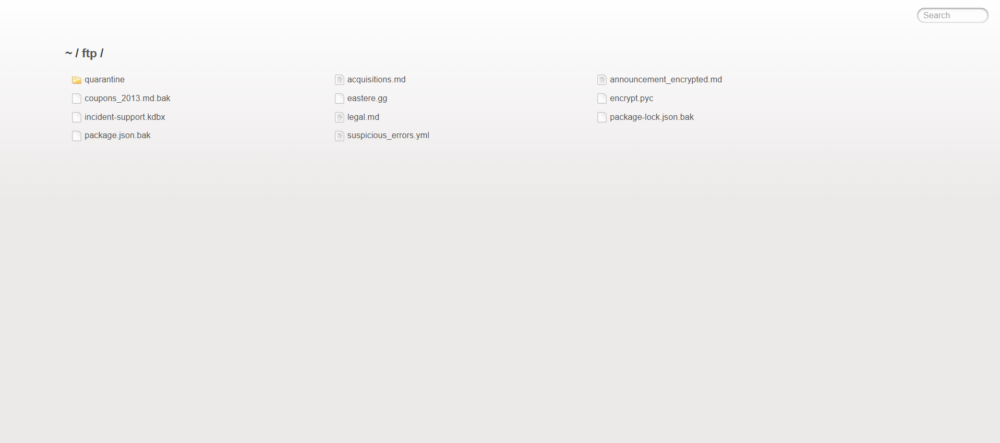
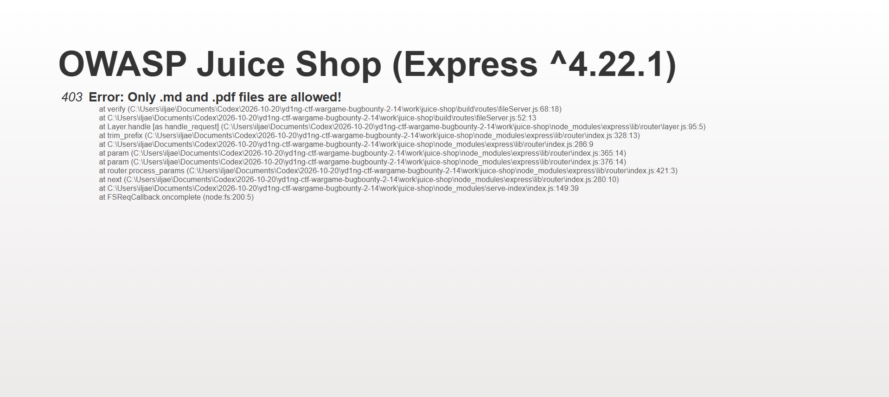
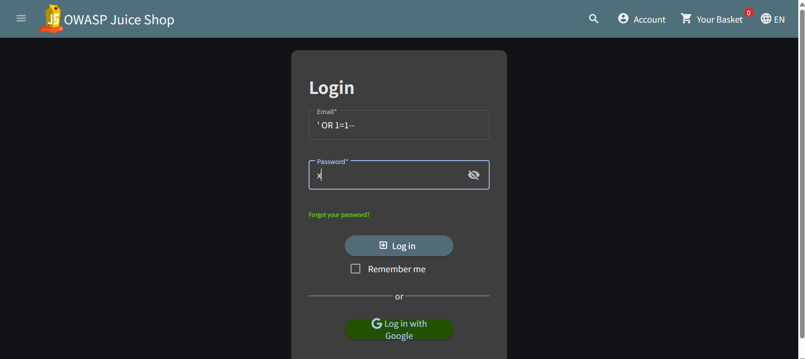
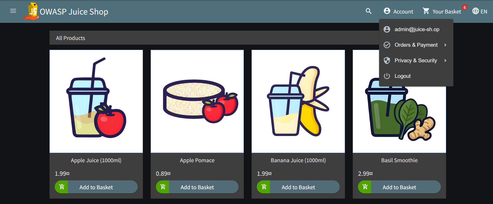

## 1. 개요

OWASP Top 10을 기준으로 웹 애플리케이션 모의침투의 전체 흐름을 경험

1. 정보 수집
2. 취약점 탐색 및 검증
3. 취약점 연결을 통한 공격 시나리오 설계
4. 영향도와 대응 방안 문서화

대상은 OWASP가 교육·보안 인식·CTF 용도로 제공하는 의도적 취약 웹 애플리케이션인 **OWASP Juice Shop**이다. 공식 저장소는 Juice Shop을 현대적인 웹 애플리케이션에서 발견되는 OWASP Top 10 및 기타 보안 결함을 연습하기 위한 프로젝트이다. [공식 저장소](https://github.com/juice-shop/juice-shop)

로컬 인스턴스만 대상으로 했고, 외부 서버에는 요청을 보내지 않았다.

## 1.1 테스트 범위와 진행 기준

이번 테스트의 범위는 `127.0.0.1:3000`에서 실행한 Juice Shop 한 개 인스턴스다. 계정 탈취나 데이터 변경을 목적으로 하지 않고, 읽기 요청과 브라우저에서 확인 가능한 결과까지만 검증했다.

각 항목은 다음 기준으로 기록했다.

- **발견**: 경로·기능·응답이 존재하는지 확인
- **검증**: 입력값을 넣은 뒤 예상한 상태 변화나 응답이 나오는지 확인
- **영향**: 실제로 확인한 범위와 가능성에 근거한 조건부 영향을 구분
- **미수행**: 쓰기·삭제·대량 요청처럼 서비스 상태를 바꿀 수 있는 테스트는 제외

## 2. 실습 환경

| 항목 | 값 |
| --- | --- |
| 운영체제 | Windows / PowerShell |
| Node.js | v24.20.0 |
| 대상 소스 | OWASP Juice Shop 공식 저장소 |
| 검증 커밋 | `399fba76194305a312693eee44f4df64bdf0c3ce` |
| 실행 주소 | `http://127.0.0.1:3000` |
| 데이터베이스 | SQLite |

Docker가 설치되어 있지 않아 공식 저장소를 `work/juice-shop`에 shallow clone한 뒤 소스에서 실행했다. 프런트엔드 production build와 서버 TypeScript build가 모두 성공했다. 처음 서버를 실행했을 때 SQLite native binding이 없다는 오류가 발생했으며, `npm rebuild sqlite3 --no-audit --no-fund`로 보완한 후 서버가 정상적으로 시작했다.

### 2.1 실행 방법

다른 환경에서 재현할 때는 아래처럼 실행하면 된다.

```powershell
git clone --depth 1 https://github.com/juice-shop/juice-shop.git
cd juice-shop
npm install
npm rebuild sqlite3 --no-audit --no-fund
npm run build:frontend
npm run build:server
node build/app.js
```

서버가 실행되면 브라우저에서 `http://127.0.0.1:3000`으로 접속한다. 이후의 테스트는 모두 이 로컬 주소를 대상으로 진행했다.

## 3. 정보 수집

### 3.1 기본 엔드포인트 확인

브라우저와 HTTP 요청으로 애플리케이션의 기본 노출면을 확인했다.

처음부터 모든 경로를 추측한 것이 아니라, 메인 화면에서 상품 검색 기능을 사용한 뒤 개발자 도구의 Network 탭에서 실제 요청 경로를 확인했다. 그 결과 `/rest/products/search` 같은 REST API가 확인됐고, 페이지에서 연결되는 `/api-docs`와 파일 경로로 보이는 `/ftp/`도 직접 요청해 응답 상태와 내용을 비교했다.

| 요청 | 결과 | 관찰 내용 |
| --- | --- | --- |
| `GET /` | `200` | Angular 기반 상품 페이지 |
| `GET /rest/products/search?q=test` | `200` | JSON 상품 검색 API |
| `GET /api-docs` | `301` | API 문서 경로 존재 |
| `GET /ftp/` | `200` | 파일 목록을 보여 주는 디렉터리 인덱스 |

정찰 단계에서 확인한 내용을 기능별로 나누면 다음과 같다.

| 기능 | 확인 방법 | 확인한 결과 |
| --- | --- | --- |
| 프런트엔드 | `/` 접속 | Angular 상품 페이지와 로그인·계정 메뉴 확인 |
| 상품 API | 상품 검색 후 Network 탭 확인 | `/rest/products/search` 요청과 JSON 응답 확인 |
| API 문서 | `/api-docs` 직접 요청 | API 문서 경로가 존재하고 리다이렉트되는 것 확인 |
| 파일 서버 | `/ftp/` 직접 요청 | 디렉터리 목록과 파일명 노출 확인 |
| 인증 | `/#/login` 접속 | 로그인 요청이 `/rest/user/login`으로 전송되는 구조 확인 |

응답에는 `X-Content-Type-Options: nosniff`, `X-Frame-Options: SAMEORIGIN` 같은 보안 헤더도 있었다. 그러나 보안 헤더가 일부 설정되어 있다는 사실만으로 인증·인가나 정보 노출 문제가 해결되는 것은 아니므로, 기능별 접근 통제를 별도로 확인했다.

### 3.2 FTP 디렉터리 인덱스

`/ftp/`에서는 `package.json.bak`, `package-lock.json.bak`, `coupons_2013.md.bak`, `incident-support.kdbx`, `suspicious_errors.yml` 같은 파일명이 노출됐다.


_파일 서버가 제공하는 디렉터리 목록. 파일명만으로 백업·설정·자격 증명 저장소로 보이는 관심 대상 식별._

이 단계에서 확인된 사실은 **파일명과 크기 노출**이다.

재현 절차는 다음과 같다.

1. Juice Shop을 실행하고 `http://127.0.0.1:3000/ftp/`로 이동한다.
2. 로그인하지 않은 상태에서 파일 목록이 표시되는지 확인한다.
3. `package.json.bak`, `package-lock.json.bak`, `incident-support.kdbx` 등의 파일명이 보이는지 확인한다.
4. `coupons_2013.md.bak`를 선택해 파일 서버의 응답을 확인한다.

여기서 확인한 취약점은 백업 파일의 내용을 모두 읽었다는 것이 아니라, 인증 없이 민감할 수 있는 파일의 존재·이름·크기가 노출된다는 점이다.

### 3.3 오류 상세 정보 노출

확장자 검증 오류 화면에는 Express 버전과 서버의 로컬 절대 경로가 포함된 stack trace가 표시됐다.


_403 응답 자체는 접근을 차단했지만, 오류 화면은 내부 파일 경로와 모듈 호출 경로를 반환했다._

운영 환경에서 이런 상세 오류는 공격자에게 프레임워크·파일 구조·배포 경로를 알려 주는 정보가 된다. 애플리케이션 오류 응답은 일반화하고, 상세 stack trace는 서버 로그에만 남겨야 한다.

오류 검증은 다음 요청으로 재현했다.

```http
GET /ftp/coupons_2013.md.bak HTTP/1.1
Host: 127.0.0.1:3000
```

허용 목록에 없는 `.bak` 파일을 요청했기 때문에 상태 코드는 `403`이었다. 하지만 응답 화면에 `Only .md and .pdf files are allowed!`와 함께 `build/routes/fileServer.js`, `node_modules/express`, `serve-index` 경로가 표시됐다.

## 4. 핵심 취약점: 로그인 SQL Injection

### 4.1 입력 지점 확인

로그인 화면의 이메일 입력란과 비밀번호 입력란을 확인했다. 정상 계정 정보를 사용하지 않고, 로컬 교육용 인스턴스에 다음 테스트 문자열을 전달했다.

```http
POST /rest/user/login HTTP/1.1
Host: 127.0.0.1:3000
Content-Type: application/json

{"email":"' OR 1=1--","password":"x"}
```


_이메일 조건식에 영향을 주는 테스트 문자열과 임의의 비밀번호를 입력한 상태._

이 값의 목적은 이메일 조건을 참으로 만들고 뒤의 SQL 조건을 주석 처리하는 것이다. 비밀번호에는 실제 계정 비밀번호가 아닌 `x`를 사용했기 때문에, 정상적인 비밀번호 검증이 수행됐다면 로그인은 실패해야 한다.

### 4.2 인증 우회 결과

요청 결과는 `200 OK`였고 `authentication.token`이 발급됐다. 토큰은 저장하거나 공개하지 않고 로컬에서 사용했다.

정상적인 실패 응답과 비교하면 차이가 분명했다. 임의의 일반 이메일과 비밀번호를 입력했을 때는 인증 실패 응답이 반환됐지만, 아래 요청에서는 성공 응답과 토큰이 반환됐다.

```http
HTTP/1.1 200 OK
Content-Type: application/json

{
  "authentication": {
    "token": "<로컬 세션 토큰>",
    "bid": 1,
    "umail": "admin@juice-sh.op"
  }
}
```

토큰 원문은 글에 남기지 않고 `<로컬 세션 토큰>`으로 가렸다. 따라서 재현 시에는 응답에 `authentication` 객체와 사용자 이메일이 반환되는지 확인하면 된다.

브라우저의 계정 메뉴에서 `admin@juice-sh.op`가 표시되는 것까지 확인해 인증 우회 결과를 검증했다.

같은 요청은 공백을 포함한 주석 변형에서도 재현됐다. 따라서 단순히 오류 페이지가 발생한 것이 아니라, 사용자 입력이 로그인 쿼리의 논리에 영향을 주어 인증이 우회된 것으로 보았다.

검증 결과를 단계로 정리하면 다음과 같다.

| 단계 | 입력·요청 | 관찰 결과 |
| --- | --- | --- |
| 정상 실패 기준 | 임의의 일반 이메일 + 잘못된 비밀번호 | 인증 실패 |
| 공격 입력 | 이메일 `' OR 1=1--`, 비밀번호 `x` | `200 OK`와 `authentication` 객체 반환 |
| 신원 확인 | 로그인 후 Account 메뉴 열기 | `admin@juice-sh.op` 표시 |
| 권한 확인 | 관리자 읽기 API 요청 | 설정·챌린지·장바구니 응답 반환 |

### 4.3 관리자 세션 확인

발급된 세션으로 계정 메뉴를 열어 현재 로그인 주체를 확인했다.


_계정 메뉴에 `admin@juice-sh.op`가 표시되어 관리자 세션 발급을 확인했다._

재현 순서는 다음과 같다.

1. `/`에서 Account 메뉴를 열고 Logout 상태인지 확인한다.
2. `/#/login`으로 이동한다.
3. 이메일에 `' OR 1=1--`, 비밀번호에 `x`를 입력한다.
4. 로그인 후 Account 메뉴를 다시 연다.
5. 메뉴에 `admin@juice-sh.op`가 표시되면 인증 우회가 성공한 것이다.
6. 같은 세션으로 아래 읽기 요청을 보내 `200` 응답을 확인한다.

```http
GET /rest/admin/application-configuration HTTP/1.1
Host: 127.0.0.1:3000
Cookie: <로그인 후 발급된 로컬 세션>
```

이 과정에서 쓰기·삭제 요청은 보내지 않았기 때문에 데이터 변조까지 성공했다고 기록하지 않았다.

HTTP 요청으로도 같은 세션을 검증했다.

| 요청 | 결과 |
| --- | --- |
| `GET /rest/admin/application-configuration` | `200`, 약 36 KB 설정 응답 |
| `GET /api/Challenges` | `200`, 챌린지 메타데이터 응답 |
| `GET /rest/basket/1` | `200`, 보호된 장바구니 응답 |

이 검증에서는 데이터 변경·삭제 요청을 보내지 않았다. 따라서 관리자 API가 제공하는 모든 변경 기능이 실행됐다고 주장하지 않고, 실제로 읽기 요청에서 확인한 권한 상승 범위만 기록한다.

## 5. 공격 체인 설계

이번 실습에서 가장 중요한 부분은 하나의 취약점이 다음 접근 권한으로 이으는 것이었다.

```mermaid
flowchart LR
  A[로그인 이메일 입력] --> B[SQL Injection]
  B --> C[관리자 인증 토큰 발급]
  C --> D[관리자 계정 메뉴 확인]
  D --> E[관리자 설정 API 접근]
  E --> F[내부 구성·보호된 데이터 노출]
  G[/ftp/ 디렉터리 인덱스] --> H[백업·설정 파일명 수집]
  H --> I[오류 응답에서 내부 경로 노출]
```

정리하면 핵심 공격 체인은 다음과 같다.

```text
로그인 SQL Injection
  → 인증 우회
  → 관리자 세션 발급
  → 관리자 API 접근
  → 내부 설정 및 보호된 업무 데이터 조회
```

각 단계가 다음 단계로 이어지는 이유는 다음과 같다.

| 단계 | 공격자가 얻는 것 | 다음 단계와의 연결 |
| --- | --- | --- |
| 로그인 입력 조작 | 인증 조건에 영향을 줄 수 있음 | 정상 계정 확인 없이 로그인 시도 |
| 인증 우회 | 관리자 주체의 세션·토큰 | 관리자 전용 기능 요청 가능 |
| 관리자 세션 | 역할이 포함된 인증 상태 | 관리자 API 권한 검사 대상이 됨 |
| 관리자 API 조회 | 설정·챌린지·장바구니 데이터 | 기밀성 침해 범위 확인 |
| FTP·오류 정보 | 백업 파일명·프레임워크·경로 정보 | 후속 탐색에 필요한 내부 정보 확보 |

이번 실습에서 실제로 확인한 공격 체인은 **SQL Injection → 관리자 세션 → 관리자 읽기 API**다. FTP와 오류 상세 정보는 별도로 존재하지만, 내부 구조와 후속 공격 지점을 파악하는 정찰 정보로 결합될 수 있다.

## 6. 영향도 분석

### 기밀성(Confidentiality)

- 관리자용 애플리케이션 설정 응답 조회
- 챌린지와 API 구조에 대한 상세 메타데이터 조회
- 관리자 장바구니 데이터 조회
- 파일 서버의 백업·설정 파일명과 내부 경로 노출

### 무결성(Integrity)

현재 단계에서는 변경하지 않았다. 인증 주체가 관리자이므로, 관리자용 쓰기 API가 같은 세션을 신뢰한다면 주문·상품·사용자 데이터 변조로 확대될 수 있다. 이 부분은 실제 변경 요청을 하지 않았으므로 **조건부 영향**으로 표시해놨다.

### 가용성(Availability)

이번 테스트에서는 삭제·대량 요청·부하 유발 행위를 하지 않았다. 가용성 영향은 확인되지 않았다.

### 위험도

로그인 SQL Injection은 정상 비밀번호 없이 관리자 세션을 발급하므로 High로 평가했다. 파일명·stack trace 노출은 단독으로는 중간 수준의 정보 노출이지만, 인증 우회와 결합되면 후속 탐색 비용을 낮추는 보조 정보가 된다.

| 취약점 | 기밀성 | 무결성 | 가용성 | 판단 |
| --- | --- | --- | --- | --- |
| 로그인 SQL Injection | 관리자 데이터 조회 가능 | 쓰기 API가 같은 세션을 신뢰하면 영향 가능 | 이번 테스트에서는 확인하지 않음 | High, 실제 쓰기는 미검증 |
| FTP 디렉터리 인덱스 | 민감 파일 존재 정보 노출 | 직접적인 변경은 확인하지 않음 | 영향 없음 | 정보 노출 |
| 상세 오류·스택 트레이스 | 서버 구조·경로 노출 | 직접 영향 없음 | 영향 없음 | 정보 노출 |

## 7. 대응 방안

### 7.1 SQL Injection 방어

OWASP는 SQL Injection 대응의 우선순위로 prepared statement/parameterized query를 제시한다. 문자열 연결로 SQL을 만들지 말고, 쿼리 구조와 사용자 데이터를 분리해야 한다.

- ORM의 bind parameter 또는 prepared statement 사용
- 이메일 형식 검사는 보조 방어로만 사용
- 입력값 escape만으로 방어하려 하지 않기
- 애플리케이션 DB 계정에 최소 권한 부여
- SQL Injection payload를 포함한 로그인 회귀 테스트 추가

참고: [OWASP SQL Injection Prevention Cheat Sheet](https://cheatsheetseries.owasp.org/cheatsheets/SQL_Injection_Prevention_Cheat_Sheet.html)

### 7.2 인증·인가 방어

로그인 성공 여부만 확인하는 것이 아니라, 매 요청마다 서버 측에서 역할과 리소스 권한을 검증해야 한다.

- 관리자 API는 deny-by-default 정책 적용
- 사용자·역할·리소스 소유권을 매 요청 검증
- 세션·JWT 만료와 폐기 정책 적용
- 로그인 rate limit, 감사 로그, 이상 로그인 탐지 추가
- 관리자 설정 API는 필요한 항목만 allow-list로 반환

참고: [OWASP Authorization Cheat Sheet](https://cheatsheetseries.owasp.org/cheatsheets/Authorization_Cheat_Sheet.html)

### 7.3 파일 서버와 오류 처리

- 운영 환경에서 디렉터리 인덱싱 비활성화
- 백업 파일을 웹 루트 밖에 보관
- `.bak`, `.kdbx`, 설정·로그 파일의 배포 차단
- 오류 응답에는 일반화된 메시지만 반환
- stack trace와 절대 경로는 서버 로그에만 기록
- 정적 파일 allow-list와 canonical path 검증 적용

### 7.4 수정 후 재검증 항목

수정이 적용됐는지는 다음 기준으로 다시 확인해야 한다.

- `' OR 1=1--` 입력 시 로그인 실패 응답이 반환되는지 확인
- 인증되지 않은 상태에서 `/ftp/` 디렉터리 인덱스가 비활성화됐는지 확인
- `.bak`, `.kdbx`, 설정 파일 요청이 외부에 노출되지 않는지 확인
- 오류 응답에 프레임워크 버전·절대 경로·stack trace가 포함되지 않는지 확인
- 일반 사용자 세션으로 관리자 API에 접근했을 때 `401` 또는 `403`이 반환되는지 확인
- 정상 사용자의 로그인과 상품 검색이 수정 후에도 동작하는지 확인

## 8. 검증 결과와 한계

이번 글에서 **확인**으로 표시한 것은 로컬 인스턴스에서 실제 HTTP 응답 또는 브라우저 화면으로 재현한 항목이다. 관리자 쓰기 작업, 파일 내용 탈취, 외부 서비스 공격은 하지 않았다.

| 항목 | 상태 |
| --- | --- |
| 로컬 Juice Shop 실행 | 확인 |
| 기본 API·FTP 경로 발견 | 확인 |
| FTP 디렉터리 파일명 노출 | 확인 |
| 확장자 오류의 내부 경로 노출 | 확인 |
| 로그인 SQL Injection | 확인 |
| 관리자 세션 발급 | 확인 |
| 관리자 읽기 API 접근 | 확인 |
| 관리자 데이터 변경 | 수행하지 않음 |
| 외부 대상 테스트 | 수행하지 않음 |

### 8.1 재현 결과 요약

| 검증 항목 | 재현 입력 | 기대 결과 | 실제 결과 |
| --- | --- | --- | --- |
| 관리자 로그인 | 이메일 `' OR 1=1--`, 비밀번호 `x` | 정상 비밀번호가 없어 로그인 실패 | `200 OK`, 관리자 세션 확인 |
| FTP 목록 | `GET /ftp/` | 인증 없이는 목록이 보이지 않음 | 파일명·크기 목록 표시 |
| 잘못된 파일 접근 | `GET /ftp/coupons_2013.md.bak` | 일반화된 오류만 표시 | 403과 내부 stack trace 표시 |
| 관리자 읽기 API | 관리자 세션으로 `GET /rest/admin/application-configuration` | 권한에 맞는 응답 | `200`과 설정 응답 확인 |

## 9. 마무리

먼저 노출면을 정리하고, 입력 지점을 찾고, 인증 경계를 넘었는지 확인한 다음, 실제 권한으로 접근 가능한 API와 영향 범위를 단계적으로 검증해야 한다.

특히 로그인 SQL Injection은 다음과 같은 공격 체인을 만들었다.

```text
입력 조작 → 인증 우회 → 관리자 세션 → 관리자 API → 내부 데이터 조회
```

보고서에서는 확인된 사실, 조건부 영향, 아직 검증하지 않은 부분을 구분해야 재현성과 신뢰도를 함께 확보할 수 있다.

### 참고 자료

- [OWASP Juice Shop 공식 GitHub 저장소](https://github.com/juice-shop/juice-shop)
- [OWASP Juice Shop 공식 프로젝트 페이지](https://owasp-juice.shop/)
- [OWASP SQL Injection Prevention Cheat Sheet](https://cheatsheetseries.owasp.org/cheatsheets/SQL_Injection_Prevention_Cheat_Sheet.html)
- [OWASP Authorization Cheat Sheet](https://cheatsheetseries.owasp.org/cheatsheets/Authorization_Cheat_Sheet.html)
