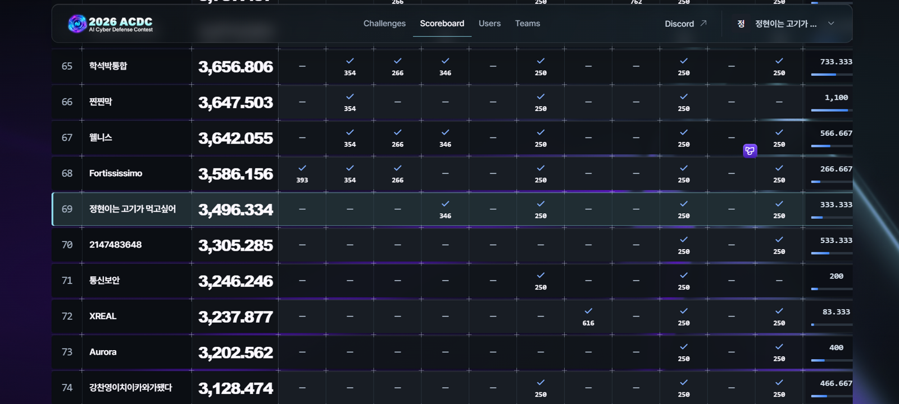

어제(10/31) **AI Cyber Defense Contest(ACDC) 예선**에 나갔다. 결과부터 말하면 **69위(3,496.334점)로 본선 진출에는 실패**했다. 아쉬운 결과지만, 풀면서 배운 것이 많아서 기억이 흐려지기 전에 정리해 둔다.

## 대회 정보

| 항목 | 내용 |
| --- | --- |
| 대회 | AI Cyber Defense Contest 예선 (온라인) |
| 팀명 | 정현이는 고기가 먹고싶어 |
| 팀원 | 나(팀장), 김정현(2학년, 동아리 동기), 양승권(3학년, 동아리 선배) |
| 결과 | 69위, 총점 3,496.334, 본선 진출 실패 |



## 어떤 문제를 시도했나

이번에 내가 시도한 문제는 모두 **KOTH(King of the Hill)** 계열이었다. 내가 만든 코드나 모델을 제출하면 서버에서 다른 팀의 제출물과 겨루고, 그 결과로 점수가 매겨지는 방식이다. 총 3개를 풀어봤는데, 그중 인상 깊었던 **BATTLE**과 **King of the Brick-Breaker** 두 문제를 중심으로 적었다.

## BATTLE

### 문제 소개

BATTLE은 Python 코드로 유닛을 직접 제어하는 1대1 실시간 전략형 문제다. 수송차로 자원을 채굴하고, 모은 자원으로 병력을 생산한 뒤, 유닛을 이동·조준·사격시켜 **상대 코어를 먼저 파괴**하면 이긴다.

단순히 적을 향해 이동하는 것만으로는 해결하기 어려웠다. 다음 요소를 하나의 전략 안에서 동시에 처리해야 했다.

- 제한된 시야로 적의 위치와 위협 판단
- 광산 채굴과 자원 운반
- 탱크·공성 유닛·전투기 생산
- 바위와 구조물을 피하는 경로 탐색
- 포탄의 속도와 낙하를 고려한 조준
- 유닛끼리 길을 막지 않도록 이동 제어
- 0.5초마다 주어지는 짧은 판단 시간 준수

외부 라이브러리와 인터넷을 쓸 수 없고 경기당 CPU 계산 시간도 10초로 제한되어 있었다. 그래서 복잡한 AI 모델보다는 **빠르고 결과가 일정한 규칙 기반 전략**으로 가닥을 잡았다.

### 전체 전략

흐름은 `채굴 → 병력 생산 → 전장 이동 → 위협 제거 → 상대 코어 공격`으로 잡았다.

- 수송차 두 대를 각각 아군 진영 광산에 배치하고, 화물이 일정량 쌓이면 기지로 돌아와 내려놓도록 했다.
- 시작 지점 광산이 고갈되면 확장 지역으로 이동해 보급소를 짓고 추가 자원을 확보하게 했다.
- 병력은 공성 유닛과 탱크 중심에 전투기 한 대를 보조로 붙이는 구성을 목표로 했다.
- 초반부터 자원을 병력에 전부 쓰면 확장용 보급소를 못 지으므로, 일정 금액은 남겨 두도록 생산 조건을 걸었다.

### 이동 문제

유닛이 상대 코어로 가는 길에 바위와 아군 구조물에 자주 막혔다. 먼저 직선 이동이 가능한지 검사하고, 막혀 있으면 맵을 격자로 나눠 **A\* 알고리즘**으로 우회 경로를 계산했다. 계산된 경로는 장애물과 충돌하지 않는 범위에서 중간 지점을 생략해 단순화했다.

또 뒤에서 출발한 빠른 유닛이 앞의 느린 공성 유닛을 밀거나 길을 막는 문제가 있었다. 먼저 생성된 유닛에 우선권을 주고, 앞에 아군이 너무 가까이 있으면 잠시 정지하도록 처리해서 줄였다.

### 조준과 전투

사격은 적의 현재 위치를 그대로 겨누지 않았다. 포탄에 속도와 중력이 적용되기 때문에 거리와 높이로 발사 각도와 세기를 계산하고, 움직이는 적은 예상 비행시간 동안 이동할 거리까지 반영해 조준점을 보정했다.

표적 우선순위는 이렇게 뒀다.

1. 아군 코어 주변에 접근한 적을 먼저 공격
2. 공성 유닛을 가장 위험한 대상으로 판단
3. 탱크는 가까운 적 전투기가 있으면 대공 무기로 전환
4. 처리할 적이 없으면 상대 코어 공격

공성 유닛들은 모두 같은 지점으로 몰리지 않도록 유닛마다 조금씩 다른 공격 지점을 배정했다.

### 테스트 결과와 한계

로컬에서 여러 시드로 정지 상태의 상대와 붙였을 때는 모두 상대 코어를 파괴했다. 시드 17에서는 231번의 판단 만에 끝났고 잘못된 명령으로 거절된 요청도 없었다. 다른 테스트에서는 약 188번의 판단으로 코어를 부수기도 했다. 제출 ZIP 검사도 통과했다.

```text
status: format_ok
files: 6
```

하지만 같은 전략끼리 붙이는 **미러 테스트**에서는 양쪽이 병력만 소모하고 코어 체력은 그대로 남아 시간 초과 무승부가 났다. 기본 흐름(채굴, 생산, 이동, 조준)은 안정적이었지만, **비슷한 전력의 상대를 이기는 대응 전략**은 부족하다는 걸 확인했다.

## King of the Brick-Breaker

### 문제 소개

벽돌깨기 게임을 플레이하는 **에이전트를 만들어 ZIP으로 제출**하는 문제였다. 제출물에는 에이전트 코드와 모델 파일이 들어간다. 제공된 SDK와 제출 예시 파일을 바탕으로 작업했다.

평가 방식은 다음과 같았다.

- 라운드마다 3개 맵, 맵당 최대 300초
- 점수는 **블록 파괴율**과 **클리어 시간**으로 결정
- 동점이면 먼저 제출한 팀이 우선
- 테스트 플레이는 팀당 라운드 2회, 1분 간격으로 제한

동점이면 먼저 제출한 팀이 유리하고 테스트 횟수도 적어서, 한 번 한 번의 제출을 신중하게 해야 했다.

### 접근 과정

BATTLE은 규칙을 보고 바로 전략을 그려 볼 수 있었던 반면, 이 문제는 **"어떤 방식으로 에이전트를 만들 것인가"** 를 정하는 것부터 고민이었다. 제출물에 에이전트 코드와 모델 파일이 함께 들어가는 구조라 접근할 수 있는 방향이 넓었고, 그만큼 어디서부터 손을 대야 할지 감을 잡기 어려웠다. 제공된 SDK와 제출 예시 파일을 먼저 살펴보고, Claude의 도움을 받아 작업을 진행했다.

## 대회를 마치고

### 느낀 점

지난 **CCE, DEFCON**에서 비슷한 계열의 문제를 접해 본 적이 있어서, 처음 문제를 봤을 때는 "생각보다 할 만하겠다"는 생각이 들었다. 하지만 막상 시작해 보니 상황이 달랐다.

- **토큰이 부족했다.** 여러 문제를 동시에 건드리다 보니 작업할 수 있는 양이 금방 한계에 닿았다.
- **어떤 식으로 접근할지가 가장 큰 고민이었다.** 익숙한 계열이라는 느낌과 실제로 점수가 나오는 해법을 만드는 일은 별개였다.
- 문제 하나를 잘 푸는 것보다 **기본 흐름을 먼저 끝까지 돌아가게 만드는 것**이 중요했다. BATTLE에서 개별 기능이 맞아도 연결해서 돌려 보면 전혀 다른 문제가 생겼다.
- KOTH는 정적인 정답이 아니라 **다른 팀과의 상대적 성능**으로 평가된다. 정지한 상대를 이기는 것과 전략을 가진 상대를 이기는 것은 완전히 다른 문제였다.
- 선배, 동기와 함께 팀으로 대회를 경험한 것 자체가 큰 공부였다.

### 아쉬운 점

- 69위로 본선 진출에 실패했다. 문제를 여러개 풀려고 시도했지만 하나하나를 끝까지 다듬을 여유가 없었다.
- 제한된 토큰을 어디에 쓸지 미리 계획하지 못했다.
- BATTLE에서는 미러전 무승부를 해결하지 못했다. 상대 병력 구성에 대응하는 로직이 없었다.

### 다음에 준비하고 싶은 것

- 경기 기록을 분석해 상대 병력 구성을 추정하고, 그에 맞춰 생산 비율을 바꾸는 **동적 생산 전략** 만들기
- 공격 타이밍과 병력 집결 조건을 조정해 소모전과 무승부를 줄이기
- 대회 전에 KOTH류 문제를 미리 풀어 보며 **접근 방식의 틀**을 만들어 두기
- 토큰(사용량)을 문제별로 **미리 배분**하고 우선순위 정하기
- 팀원끼리 문제 분담과 제출 일정을 미리 정해 두기

이번에 부족했던 부분을 정리해 두었으니, 다음 대회에서는 더 나은 결과로 후기를 쓰고 싶다.
