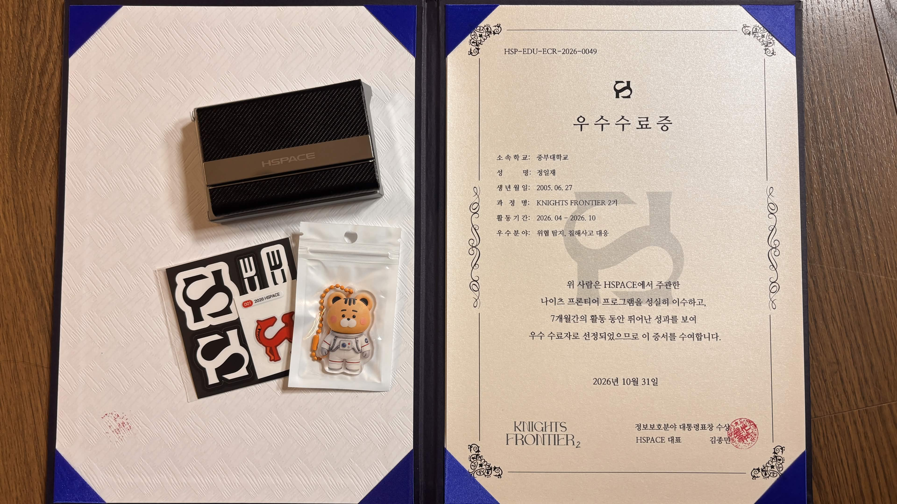

## 시작하며: 비어 있던 블로그에서 55개의 별까지

2026년 4월, 나이츠 프론티어 2기를 시작하면서 블로그를 처음 정리했다. 당시 첫 회고에는 CTF, 워게임, 버그바운티, 논문·컨퍼런스 카테고리를 만들어 놓고도 채울 내용이 거의 없다는 사실이 부끄럽고 막막하다고 적었다. 보안을 어떻게 공부해야 하는지 몰랐고, 개발 경험은 있었지만 그것을 보안 역량으로 연결하는 방법도 잘 알지 못했다.

그로부터 7개월이 지난 지금은 그때 비어 있던 칸마다 직접 수행한 미션과 실패, 분석 기록이 남아 있다. 나이츠 프론티어 2기에서 **총 55개의 별을 획득해 별 개수 기준 2위**로 마무리했고, **우수 수료자 5명 중 한 명**으로 선정되었다. 숫자 자체도 기쁘지만, 내게 더 중요한 것은 55개의 별로 이어진 과정에서 무엇을 공부했고 어떤 방식으로 문제를 풀었는지가 블로그에 남아 있다는 점이다.


_2026년 4월부터 10월까지의 활동을 마치고 받은 나이츠 프론티어 2기 우수 수료증. 우수 분야는 위협 탐지와 침해사고 대응이다._

## 어떤 미션들을 해왔는가

모든 미션을 한 줄씩 나열하기보다, 지난 7개월 동안 내가 어떤 방향으로 공부의 범위를 넓혔는지를 중심으로 돌아보고 싶다.

### 1. 기초를 다시 쌓고 기록하는 습관

초반에는 진로 가치관과 보안 시장을 조사하고, Git과 Linux 명령어, 네트워크와 운영체제 같은 기초를 다시 공부했다. OverTheWire Bandit을 풀며 셸 환경에 익숙해졌고, 실제 보안 사고를 분석하면서 사건의 원인과 대응을 내 언어로 정리하려고 했다.

처음에는 미션을 끝내기 위해 글을 썼지만, 점차 기록 자체가 분석 과정의 일부가 되었다. 명령어만 남기는 것이 아니라 왜 그 명령을 사용했는지, 어떤 가설이 틀렸는지, 결과를 다시 확인하려면 무엇이 필요한지를 함께 적었다. 블로그는 결과를 자랑하는 공간이라기보다 내 판단을 검증하는 실험 노트에 가까워졌다.

### 2. Android 보안을 하나의 흐름으로 공부하기

가장 많이 성장했다고 느끼는 분야 중 하나는 Android 보안이다. 처음에는 계산기 APK의 특정 동작을 추적하는 작은 리버싱 문제에서 시작했다. 이후 AndroGoat, OWASP MASTG Hacking Playground의 취약점 24종, HexTree Android Track 14개 과정, Allsafe Android의 12개 챌린지를 차례로 진행했다.

ADB와 JADX로 앱 구조를 살펴보는 것에서 출발해 Intent, exported component, ContentProvider, WebView, 로컬 저장소, 인증서 피닝, Smali 패치, JNI와 Frida 후킹까지 범위를 넓혔다. 이 과정에서 도구 사용법만 익힌 것이 아니라 다음과 같은 반복 가능한 분석 순서를 만들 수 있었다.

```text
Manifest와 외부 진입점 확인
→ 코드와 데이터 흐름 추적
→ 정적 분석으로 가설 수립
→ 에뮬레이터에서 동적 검증
→ 실제 영향과 한계 구분
→ 수정 방안 정리
```

처음에는 플래그를 얻으면 풀이가 끝났다고 생각했다. 지금은 어떤 Android 버전과 환경에서 재현되는지, 공격자가 어떤 조건을 갖춰야 하는지, 최신 플랫폼의 보호 장치로 차단되는 부분은 무엇인지까지 확인해야 분석이 완성된다고 생각한다.

### 3. 논문과 공개 자료를 내 관점으로 읽기

스마트홈의 숨겨진 속성과 가시성 격차를 다룬 CCS 논문을 읽으며 논문의 공격 과정을 요약하는 데서 멈추지 않고, 로그가 생성되지 않는 상황이 디지털 포렌식의 증거 수집에 어떤 영향을 주는지 생각해 보았다. DEF CON 33의 포켓몬 GO 안티 치트 발표도 내가 좋아하는 주제와 리버싱을 연결해 정리했다.

위협 인텔리전스 미션에서는 악성코드명, 캠페인명, 공격 그룹명을 쉽게 같은 것으로 단정하면 안 된다는 점을 배웠다. 여러 보고서의 코드, TTP, 인프라 중복을 비교하고도 확정할 수 없는 부분은 미확정으로 남겨야 했다. 자료를 많이 모으는 것보다 출처의 표현과 확신도를 정확히 구분하는 일이 더 중요했다.

### 4. 취약점을 찾는 것에서 공격 흐름을 설명하는 것으로

퍼징의 원리와 퍼저들을 조사한 뒤 AFL++로 첫 크래시를 재현했고, Fuzzing101의 Xpdf, libexif, TCPdump 과제를 수행했다. CVE-2019-19363 원데이 분석에서는 프린터 드라이버의 잘못된 파일 권한이 어떻게 SYSTEM 권한 코드 실행으로 연결되는지 공개 자료와 격리된 모형을 통해 확인했다.

GitLab 모의침투 시나리오에서는 실제 서비스에 능동적인 테스트를 하지 않고 공개 정보만으로 인증 토큰, CI/CD, Runner, Registry와 배포 환경의 신뢰 경계를 그렸다. OWASP Juice Shop 로컬 환경에서는 SQL Injection에서 관리자 세션과 읽기 API로 이어지는 공격 체인을 검증했다. 이 두 미션을 통해 취약점 하나를 발견하는 것보다 **어떤 조건에서 어디까지 영향이 이어지는지**, 그리고 **어느 통제 지점에서 공격을 끊을 수 있는지** 설명하는 역량이 중요하다는 것을 배웠다.

### 5. Live A&D에서 배운 실패의 가치

가장 강하게 기억에 남는 활동 중 하나는 **Live Attack & Defense CTF**였다. 일반적인 Jeopardy CTF와 달리, 우리 서비스를 계속 살려 두면서 동시에 다른 팀의 취약점을 찾아 공격해야 하는 실시간 공방전이었다. 여기에 AI를 이용한 공격·방어 에이전트까지 결합되어 있어, 문제 하나를 푸는 것보다 전체 시스템을 이해하고 안정적으로 운영하는 일이 먼저였다.

결과만 보면 우리 팀은 공격에 한 번도 성공하지 못했다. 실행 직후에는 OpenRouter API의 `429 Too Many Requests` 오류가 발생했고, 이를 넘기자 PoC 제출 과정에서 `flag_id`가 사라지는 `422 Unprocessable Entity` 오류가 이어졌다. 공격이 막힌 동안에는 방어 에이전트가 잘못된 패치를 반복 적용해 오히려 우리 서비스의 문법을 깨뜨리고 서버를 멈추게 했다.

팀원들과 `agent.py`, `logger.py`, `wrapper_client.py` 사이의 데이터 흐름을 추적하고, API 속도 제한에 대응하는 백오프 재시도 로직을 추가했다. FastAPI 엔드포인트와 Docker 환경을 확인하고, 자동 패치가 서비스를 망가뜨리지 않는지 로컬 샌드박스에서 검증하려고 했다. 끝내 점수를 얻지는 못했지만 마지막 라운드까지 시스템을 정상화하기 위해 코드를 읽고 고쳤다.

이 경험은 성공한 풀이만 성장으로 남는 것이 아니라는 점을 알려주었다. 자동화와 AI 에이전트는 정상 상황의 데모보다 오류, 속도 제한, 잘못된 출력과 복구 절차에서 진짜 수준이 드러난다. Live A&D에서 얻은 0점은 아쉬운 결과였지만, 실패를 숨기지 않고 원인을 기록하며 끝까지 시스템을 붙드는 태도는 이후 미션에도 큰 영향을 주었다.

### 6. 합동강화훈련에서 배운 몰입과 자기주도성

7월에는 고려대학교 세종캠퍼스에서 진행된 **12일간의 HSPACE 합동강화훈련**에 참여했다. 첫 주에는 CS 기초를 집중적으로 공부했고, 모르는 키워드에서 계속 질문을 뻗어 나가는 옵시디언 기반 학습법을 익혔다. 정해진 내용을 외우는 것이 아니라 개념과 개념 사이의 연결을 직접 찾는 방식이었다. 체력적으로 쉽지 않은 일정이었지만 첫 시험을 한 번에 통과하며 몰입해서 공부하는 경험을 했다.

두 번째 주에는 공격, 방어, 개발 중 하나를 골라 개인 프로젝트를 진행하고 발표해야 했다. 나는 취업용으로 익숙한 주제를 고르기보다, 활동이 끝난 뒤에도 스스로 파고들고 싶은 **DS·3DS 포켓몬 사설 배포 서버 개발**을 선택했다. 과거에는 다른 사람의 분석을 보고 마법처럼 느꼈던 통신 구조를 이제는 직접 프로토콜과 패킷 단위로 뜯어보고 구현해 보고 싶었다.

DS 환경의 프로토콜과 패킷 구조를 분석한 진행 내용을 발표했고, 첫날 바로 통과해 조기 퇴소 권한을 얻었다. 합동강화훈련은 단순히 오래 공부한 활동이 아니었다. 내가 좋아하는 대상에서 보안과 개발의 문제를 스스로 정의하고, 필요한 지식을 찾아 실제 결과물로 연결할 수 있다는 자신감을 준 시간이었다. 이후에도 흥미를 동력으로 삼되, 목표와 검증 기준을 분명히 세우는 공부 방식을 이어가게 되었다.

### 7. CTF와 현장에서 배운 협업

CODEGATE와 HackTheon을 시작으로 여러 CTF에 참가했다. TJCTF 2026에서는 팀으로 1위를 경험했고, DEF CON CTF Qualifier에서는 리버싱과 패킷 복원 문제에 기여하며 673개 팀 중 6위로 본선에 진출했다. DEF CON 34 Finals에서는 BBBQ KOTH 문제를 붙잡고 VM 리버싱, 바이트코드 최적화와 실험 자동화를 반복했다.

Digital Forensic Challenge에서는 이벤트 로그, 메모리의 AES 키 스케줄과 블록체인 트랜잭션을 분석했고, JBU-CTF 수상과 CCE 본선도 경험했다. 문제를 푸는 기술뿐 아니라 어떤 문제를 중요하게 바라보는지도 접했다.

대회에서 가장 크게 달라진 점은 혼자 정답을 끝까지 완성해야만 기여라고 생각하지 않게 된 것이다. 분석 중 발견한 단서와 실패한 접근도 빠르게 공유하면 팀의 다음 판단을 돕는다. 반대로 다른 사람의 풀이를 따라가는 데서 그치지 않고, 내가 확인한 근거를 남겨야 진짜 내 경험이 된다는 것도 배웠다. 진짜로...

## 7개월 동안 달라진 점

### 막막함을 작은 검증으로 바꾸게 되었다

처음 보는 문제 앞에서 무엇부터 해야 할지 몰라 멈추는 일이 많았다. 지금도 모르는 문제는 여전히 어렵지만, 대상과 환경을 고정하고 관찰 가능한 것부터 하나씩 확인하는 습관이 생겼다. 큰 문제를 작은 가설로 나누고, 정적 분석과 동적 분석의 결과가 일치하는지 대조하면 적어도 다음에 무엇을 해야 하는지는 찾을 수 있게 되었다.

Live A&D처럼 결과가 좋지 않았던 상황에서도 오류 코드를 단서로 데이터 흐름을 좁혀 갔고, 합동강화훈련 2주차 프로젝트 선정에서는 낯선 프로토콜을 작은 기능 단위로 나누어 직접 구현했다. 두 활동은 막막함이 사라져야 시작할 수 있는 것이 아니라, 작은 검증을 시작하면 막막함을 줄일 수 있다는 것을 몸으로 익히게 했다.

### 정답보다 근거와 재현성을 중요하게 보게 되었다

같은 결과라도 우연히 한 번 성공한 것과 다른 사람이 다시 확인할 수 있는 것은 다르다. 그래서 버전, 해시, 실습 환경, 명령어와 실제 결과를 가능한 한 기록하려 했다. 확인한 사실과 가능성, 실패한 시도와 미검증 영역을 구분하는 습관도 생겼다. 보안에서 강한 표현보다 정확한 경계가 더 신뢰를 만든다는 것을 배웠다.

### 공격뿐 아니라 탐지와 대응을 함께 생각하게 되었다

초기에는 취약점을 이용해 목표 상태에 도달하는 과정이 가장 재미있었다. 미션을 계속하면서 로그에 어떤 흔적이 남는지, 탐지 규칙은 어디에 두어야 하는지, 침해 범위를 어떻게 판단하고 복구할지를 함께 보게 되었다. 우수 수료증에 적힌 **위협 탐지와 침해사고 대응**이라는 분야도 지금의 관심과 잘 맞는다.

### 도구와 AI를 결과의 대리인으로 삼지 않게 되었다

여러 미션을 빠르게 진행하며 AI의 도움을 많이 받았고, 어느 순간에는 문제의 해석과 풀이까지 의존하려는 나 자신을 발견하기도 했다. 도구가 분석 속도를 높여 주는 것은 분명하지만, 출력 내용을 직접 검증하지 못하면 그 결과는 내 실력이 아니다. 앞으로는 AI를 가설 생성, 자료 정리와 반복 작업에 활용하되, 핵심 원리와 최종 판단은 내가 설명하고 재현할 수 있어야 한다는 기준을 지키려고 한다.

## 공군 정보보호병 합격에도 이어진 경험

이번 활동 기간에 공군 정보보호병에도 합격했다. 합격이 어느 한 활동만의 결과라고 단정할 수는 없지만, 나이츠 프론티어에서 수행한 미션들은 내가 왜 보안을 공부하는지, 무엇을 직접 해봤는지, 문제를 어떤 방식으로 해결하는지를 구체적으로 말할 수 있게 해주었다.

블로그에 쌓인 분석 기록과 CTF·포렌식·Android 보안 경험, 그리고 끝까지 결과물을 만들어 본 과정이 지원을 준비하는 데 큰 힘이 되었다고 생각한다. 공부할 방향조차 몰라 막막했던 나에게 계속 도전할 과제와 동료, 공부하는 방법을 알려준 나이츠 프론티어와 HSPACE에 감사드린다. 대표님 만세.

## 앞으로 보안을 공부하는 마음가짐

55개의 별과 별 개수 2위, 우수 수료는 기쁘게 기억하고 싶다. 하지만 이 기록을 실력을 보증하는 훈장으로 생각하지는 않으려 한다. 55개의 별을 모았다는 사실보다, 수행한 미션 중 몇 개를 지금도 원리부터 다시 설명하고 변형된 환경에서 해결할 수 있는지가 더 중요하기 때문이다.

앞으로는 다음 원칙을 지키며 공부하고 싶다.

1. **기초를 건너뛰지 않기**: 운영체제, 네트워크, 프로그래밍과 암호학을 꾸준히 공부해 도구의 결과를 원리로 설명한다.
2. **깊이를 만들기**: 넓게 경험한 분야 중 Android 보안과 디지털 포렌식처럼 흥미와 강점이 만나는 주제를 더 깊게 파고든다.
3. **직접 검증하기**: 출처, 버전과 환경을 남기고, 확인한 사실과 추측을 구분한다. AI와 자동화 도구의 결과도 원본 자료와 실험으로 다시 확인한다.
4. **범위와 윤리를 먼저 생각하기**: 허가받은 환경에서만 검증하고, 실제 서비스에서는 정책과 범위를 먼저 확인한다. 공격 기법은 탐지와 대응까지 함께 고민한다.
5. **혼자만의 지식으로 남기지 않기**: 실패한 과정과 한계도 기록하고 공유하며, 팀에서는 작은 단서라도 정확하게 전달한다.

## 마치며

첫 회고에서 나는 비어 있는 카테고리들을 보며 부족함을 인정하는 것이 성장의 시작이라고 적었다. 7개월 뒤 그 빈칸은 완벽함이 아니라 수많은 시도와 실패, 그리고 다시 확인한 기록으로 채워졌다. 예전의 내가 이 블로그를 본다면 적어도 “아무것도 하지 못한 채 멈춰 있지는 않았구나”라고 말할 수 있을 것 같다.

나이츠 프론티어 2기 수료는 끝이라기보다, 이제 혼자서도 공부를 계속할 수 있는 출발선이다. 별을 모으기 위해 공부했던 시간을 지나, 앞으로는 실제 문제를 더 정확하고 책임감 있게 해결할 수 있는 보안 인재가 되기 위해 공부하겠다. 도움을 주신 운영진과 함께한 모든 분께 감사드린다.
